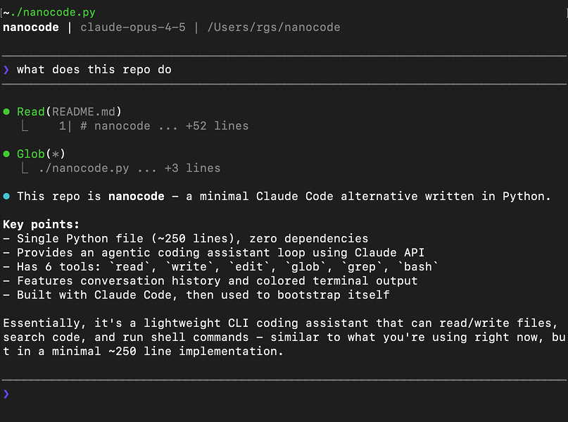

# nanocode

> 极简 Claude Code 替代品：**零第三方依赖、纯标准库**。
> 以 `nanocode.py` 为唯一入口，功能按依赖逻辑拆分到 `tools/` `knowledge/` `session/` 三个包。
> 目标是用最小代码量跑通一个完整的 **agentic coding loop（智能体编码循环）**，便于学习与二次开发。

> 用 Claude Code 构建，然后用它来构建它自己。



---

## ✨ 能力一览

- **完整 agentic loop**：模型连续多轮自主调用工具，直到给出最终答案。
- **9 个内置工具**：`read` `write` `edit` `glob` `grep` `bash` `kb_search` `skill` `record_gap`。
- **流式输出 + Spinner 动效**：模型回复边收边打印；等待首字节时原地转圈，让你知道没卡死。
- **会话与历史**：对话自动持久化、可恢复续写；文件改动全量快照，支持 `/undo` `/revert`；历史过长自动压缩。
- **领域知识库**：构建期建索引、运行期 `kb_search` 自主检索。支持 **BM25 / 向量 / 混合** 三种后端。
- **内置 SKILL 与项目记忆**：标准流程按需加载；解析 `AGENTS.md` 注入项目身份与约定。
- **四层权限防线**：高危命令硬拦 + cwd 边界 + 交互确认 + 凭证防泄漏。
- **双渠道接入**：Anthropic 风格接口 或 OpenRouter（可切换任意模型）。
- **12 个斜杠命令 + Tab 补全**：命令元数据集中一处，补全候选带中文说明。

---

## 📁 工程结构

| 文件 / 包 | 职责 |
|------|------|
| `nanocode.py` | 主入口：工具实现与注册表、流式 API 调用、agentic loop、终端交互、Spinner、四层权限防线 |
| `tools/` | 终端交互层。`commands.py`：命令元数据（`COMMANDS`）与 Tab 补全候选 |
| `knowledge/` | 领域知识层。`kb.py` 知识库检索 / `embedding.py` 本地向量后端 / `skills.py` 内置技能 / `agent_config.py` 解析 AGENTS.md / `gaps.py` 知识缺口 |
| `session/` | 会话历史层。`session.py` 会话持久化 / `changelog.py` 改动快照与回滚 / `compact.py` 历史自动压缩 |

依赖方向：`nanocode.py` → `tools` / `knowledge` / `session`。三个包之间无交叉 import，各自成一体，便于单独阅读与替换。

运行时数据目录：`.nanocode_sessions/`（每会话一个 JSON）、`.nanocode_kb/`（知识库索引）。

---

## 🚀 快速开始

```bash
# 方式一：Anthropic 风格接口
export ANTHROPIC_API_KEY="your-key"
python nanocode.py

# 方式二：OpenRouter（可切换任意模型）
export OPENROUTER_API_KEY="your-key"
export MODEL="openai/gpt-5.2"
python nanocode.py

# 可选：跳过权限确认（高危命令硬底线仍生效）
python nanocode.py --bypass
```

**依赖**：核心运行时**零第三方依赖**（纯标准库）。仅当你要用知识库的向量/混合检索后端时，才需要可选依赖 `sentence-transformers`，详见 [`requirements.txt`](requirements.txt)。

---

## 🛠 内置工具（9 个）

| 工具 | 功能 | 参数 |
|------|------|------|
| `read` | 读文件，带行号，支持 offset/limit 分段 | `path`,`offset?`,`limit?` |
| `write` | 覆盖写入文件 | `path`,`content` |
| `edit` | 字符串精确替换（默认要求唯一，`all=true` 全量替换） | `path`,`old`,`new`,`all?` |
| `glob` | 按通配符查找文件，按 mtime 倒序 | `pat`,`path?` |
| `grep` | 正则搜索内容，返回 `文件:行号:内容` | `pat`,`path?` |
| `bash` | 执行 shell 命令，实时流式输出，30s 超时 | `cmd` |
| `kb_search` | 检索领域知识库（BM25/向量/混合） | `query`,`k?` |
| `skill` | 按名称/关键词加载内置 SKILL | `name` |
| `record_gap` | 记录知识库未覆盖的问题，供后续补语料 | `question`,`context?`,`note?` |

工具在 `TOOLS` 注册表中集中定义为 `(描述, 参数 schema, 函数)` 三元组，`make_schema()` 自动转成 API 所需 JSON Schema，加工具无需改动 loop。

---

## ⌨️ 斜杠命令（12 个）

| 命令 | 作用 |
|------|------|
| `/help` | 显示帮助，列出所有命令 |
| `/sessions` | 列出历史会话（含首条消息预览） |
| `/resume <编号>` | 恢复并续写指定历史会话 |
| `/c` | 清空对话，开启全新会话 |
| `/compact` | 立即手动压缩对话历史 |
| `/changes` | 列出本项目所有文件改动记录 |
| `/undo` | 撤销最近一次文件改动 |
| `/revert <编号>` | 回滚指定编号的文件改动 |
| `/kb` | 知识库：`index`/`update`/`stat`/`model`（见下） |
| `/skills` | 列出内置 SKILL 及触发场景 |
| `/mode` | 切换权限模式 default↔bypass（或 Shift+Tab） |
| `/q`（`exit`） | 退出 |

`/` 后按 Tab 可补全命令，候选带中文说明。

---

## 📚 领域知识库

构建期把一批语料（文档/代码）切块建索引、随分发包交付；运行期模型用 `kb_search` 自主检索，命中后再决定是否 `read` 原文。

**三种检索后端**（`/kb index --backend` 或 `.nanocode_kb/config.json` 切换）：

| 后端 | 原理 | 依赖 |
|------|------|------|
| `bm25`（默认） | 稀疏词频检索 + 长度归一化 | 纯标准库 |
| `vector` | 本地 embedding 语义向量 + 余弦 Top-k | 可选 `sentence-transformers` |
| `hybrid` | BM25 + 向量用 RRF 融合 | 同 vector |

> 未装 embedding 库时，`vector`/`hybrid` 会优雅回退到 `bm25`，不影响使用。默认向量模型 `BAAI/bge-small-zh-v1.5`（约 95MB，首次使用自动下载，可用 `NANOCODE_EMBED_MODEL` 覆盖）。

**知识库命令**：

```bash
/kb index <目录> [--backend bm25|vector|hybrid]   # 全量重建
/kb update <目录> [--backend ...]                 # 增量更新（按 mtime）
/kb stat                                          # 查看概况
/kb model                                         # 预热本地 embedding 模型
```

---

## 🔒 权限安全：四层防线

| 层 | 名称 | 作用 | 能否被 bypass 跳过 |
|----|------|------|--------------------|
| ① | Deny 硬底线 | 黑名单拦截 `rm -rf /`、fork 炸弹、`mkfs`、`dd of=/dev/*` 等毁机操作 | **不能** |
| ② | cwd 边界 | 写/执行目标解析软链后须落在当前目录子树内 | 可 |
| ③ | 交互确认 | 有副作用操作执行前 `y`/`a`/`n` 确认（`a`=本类不再问） | 可 |
| ④ | 凭证防泄漏 | 读/搜命中 `.env`/`id_rsa`/`*.pem`/`.aws`/`.ssh` 等跳过，行内敏感赋值脱敏 | — |

`default` 模式四层全开；`bypass` 模式跳过 ②③（① 硬底线始终拦）。用 `--bypass` 启动或 `/mode`（Shift+Tab）切换，终端底部状态条显示当前模式。

---

## 💡 示例

```
────────────────────────────────────────
❯ what files are here?
────────────────────────────────────────

⏺ Glob(**/*.py)
  ⎿  nanocode.py
     tools/commands.py
     knowledge/kb.py
     session/session.py
     ...

⏺ The entry point is nanocode.py, with features split across the
  tools/, knowledge/, and session/ packages.
```

---

## 📖 更多

- 功能全景、迭代路线与设计决策见 [Feature-Todo-List.md](Feature-Todo-List.md)。
- 可选依赖说明见 [requirements.txt](requirements.txt)。

## License

MIT
